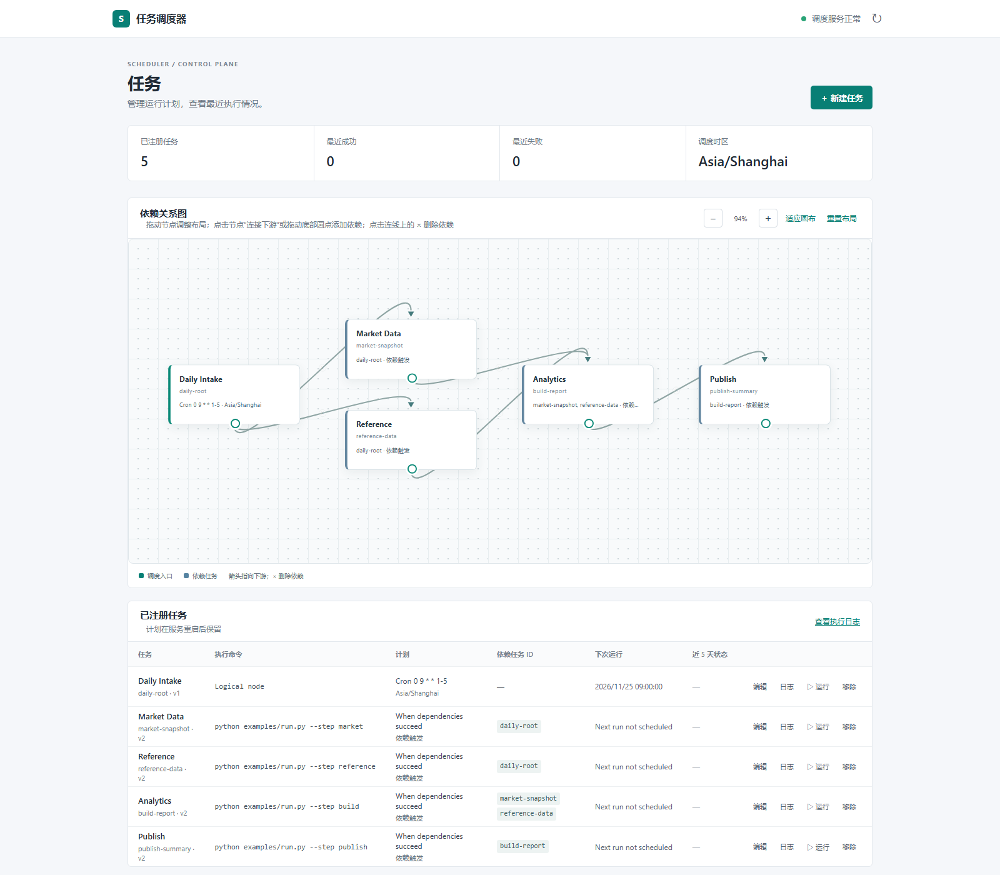

# 任务调度器

面向单机部署的持久化任务调度器，提供中文 Web 控制台和 `scheduler` 命令行。任务由可执行程序和参数组成，使用 `subprocess` 的参数数组启动，不经过 shell。适用于内部自动化和受控环境中的任务，不是多租户/分布式调度平台。



截图展示虚构任务构成的依赖工作流。

## 快速开始

项目声明支持 Python 3.9 或更新版本（见 `pyproject.toml`）；新部署建议使用仍受维护的 Python 版本。

```powershell
py -3.11 -m venv .venv
.\.venv\Scripts\Activate.ps1
python -m pip install -e ".[dev]"
scheduler serve
```

打开 `http://127.0.0.1:1000`。默认数据文件为当前目录下的 `scheduler.db`，默认时区为 `Asia/Shanghai`。服务默认只监听本机；如需远程访问，应在受控网络中通过反向代理接入，并配置身份认证和 TLS，不要直接暴露服务端口。

Linux/macOS 激活命令为 `source .venv/bin/activate`。也可用 `python -m scheduler.cli serve`。

## 命令行

注册、列表、运行和删除命令通过 HTTP API 调用运行中的调度服务，默认地址为 `http://127.0.0.1:1000`。可用 `SCHEDULER_API_URL` 更改地址；命令行不会自行启动第二个调度器实例。示例：

```powershell
scheduler add --id daily-report --name "每日报告" --every 3600 --cwd C:\jobs -- python C:\jobs\report.py --format csv
scheduler add --id weekday-check --name "工作日检查" --cron "0 9 * * 1-5" --timezone Asia/Shanghai -- python C:\jobs\check.py --strict
scheduler list
scheduler run daily-report
scheduler run daily-report --scope self
scheduler run daily-report --scope downstream
scheduler remove daily-report
```

用 `--` 分隔调度器选项和任务命令；分隔符后的词逐项作为参数传递。不要把 shell 表达式、管道或重定向当作命令传入。Cron 使用五段格式：分、时、日、月、周；数字星期遵循常见 crontab 规则，`0` 或 `7` 表示周日，`1` 至 `6` 表示周一至周六。`--at` 接受 ISO 8601 时间戳。

一个调度入口可以不带命令；下游节点通过 `--depends-on` 绑定上游。需要在自己的时点运行时，也可以给下游配置独立的 Cron：

```powershell
scheduler add --id intake --name "入口" --cron "0 9 * * 1-5" --
scheduler add --id branch-a --name "分支 A" --depends-on intake -- python C:\jobs\a.py
scheduler add --id branch-b --name "分支 B" --depends-on intake -- python C:\jobs\b.py
scheduler add --id join --name "汇合" --depends-on branch-a --depends-on branch-b -- python C:\jobs\join.py
scheduler add --id close-data --name "收盘数据" --depends-on intake --cron "30 16 * * 1-5" --timezone Asia/Shanghai -- python C:\jobs\close_data.py
```

## 项目结构

```text
scheduler/
  api.py          FastAPI 路由和应用生命周期
  cli.py          命令行参数与入口
  config.py       环境配置
  database.py     调度数据库与运行历史
  models.py       请求和响应校验模型
  service.py      调度、触发器与命令执行
  static/         Web 控制台
tests/            自动化测试
```

调度器各组件职责、任务执行契约、运行隔离边界和当前架构限制见 [`docs/architecture.md`](docs/architecture.md)。

完整文档索引、任务注册指南、API/CLI 参考、运维恢复、安全和发布流程见 [`docs/README.md`](docs/README.md)。开发 Agent 的必读顺序、代码地图和不可违反的约束见仓库根目录 [`AGENTS.md`](AGENTS.md)。

依赖工作流的注册方式、图编辑操作和运行规则见 [`docs/dependency-workflows.md`](docs/dependency-workflows.md)。

任务图定义与运行历史保存在 SQLite；APScheduler 为每个有运行计划的节点保存触发器。定时下游只会在其上游当日成功后执行，父工作流不会提前运行该定时节点。手动运行支持只运行选中任务，或运行该任务及下游；不在所选范围内的汇合上游未成功时，汇合节点会记为跳过。失败、超时或手动停止的分支会使下游跳过，独立分支继续运行。命令全局并发由 `SCHEDULER_MAX_WORKERS` 限制，错过调度在 60 秒宽限期外跳过。一次性触发执行后从计划器移除，但定义和运行历史仍保留。历史输出截断到 20 KB。

## 修改任务与查看日志

已注册任务可在任务表格或依赖图中点击“编辑”修改。任务 ID 保持稳定；名称、命令、工作目录、超时、时区、运行计划和上游依赖均可修改。保存后任务定义版本号递增，后续执行记录会保存当时使用的定义版本，已有运行历史不会被覆盖。

每个任务都能手动运行，并可选择“仅运行此任务”或“运行此任务及下游”。运行中的任务可按单次运行记录停止，框架会终止该次运行的进程树并记录为“已停止”；这不会撤销任务已经产生的外部副作用。有依赖的任务可勾选“为此任务单独设置运行计划”；计划触发时会检查所有上游在各自时区的当天是否成功。依赖图节点的“连线”操作可点选下游添加关系，连线上的 × 可删除关系。

点击任务行的“日志”会跳转至独立日志页 `/logs`，并自动筛选该任务。日志页可按任务 ID、北京时间日期和执行状态查询及分页；点开单次运行明细可查看状态、起止时间、退出码、工作流运行 ID、定义版本和截断后的标准输出/错误输出。已结束日志保留最近 5 天，服务每小时自动清理过期记录；正在运行的记录不会被清理。运行列表只返回摘要，完整输出按需读取。回刷历史数据前，需要先在任务定义中把命令参数改为目标日期，再在日志详情页选择按当前定义仅运行该节点。

API 同样支持 `PUT /api/jobs/{job_id}` 更新任务、`GET /api/runs/search?job_id={job_id}&date=YYYY-MM-DD&status=failed` 筛选记录及 `GET /api/runs/{run_id}` 查看单次运行详情。更新时路径 ID 与请求体 ID 必须一致。任务表的“依赖任务 ID”列展示当前任务的直接上游 ID；日志中的运行 ID 标识单次执行，工作流运行 ID 用于关联同一工作流内的节点。

## 配置

通过环境变量配置，详见 `.env.example`：

| 变量 | 默认值 | 说明 |
| --- | --- | --- |
| `SCHEDULER_DATABASE_URL` | `sqlite:///./scheduler.db` | SQLite 数据库 URL |
| `SCHEDULER_TIMEZONE` | `Asia/Shanghai` | 默认调度时区 |
| `SCHEDULER_HOST` | `127.0.0.1` | Web 监听地址 |
| `SCHEDULER_PORT` | `1000` | Web 监听端口 |
| `SCHEDULER_MAX_WORKERS` | `10` | 同时执行的任务数 |
| `SCHEDULER_DEFAULT_TIMEOUT` | `300` | 默认任务超时（秒） |

每个任务可独立设定时区、超时和工作目录。应用当前使用 SQLite 作为运行历史存储。

## 开发与质量门禁

```powershell
python -m pip install -e ".[dev]"
pytest
ruff check .
ruff format --check .
```

代码提交前应运行测试和 lint/format 检查。新增 API 行为要覆盖成功、无效输入和不存在资源；改动持久化或执行流程要覆盖失败与重启场景。评审应检查：

- 输入边界、时区/DST 行为、并发和错过触发后的行为是否明确。
- 命令是否继续使用参数数组；日志是否可能包含密钥或个人数据。
- 持久化兼容性、迁移/回滚影响，以及异常时是否留下误导状态。
- Web 可访问性、键盘操作、窄屏布局和空/加载/错误状态。
- 测试是否验证外部可观察行为，而非只重复实现细节。

不允许在评审中直接批准自己提交的变更。高风险执行能力或外部暴露变更需由代码所有者评审。
