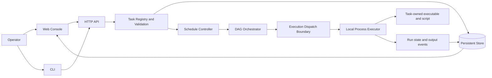

# 调度框架架构设计

## 1. 设计定位

本项目采用成熟调度平台通用的职责边界：控制面保存和校验期望任务定义、计算调度时间、编排依赖并展示运行状态；执行面根据任务定义启动作业、采集结果并回报状态。任务代码、解释器、依赖包和业务数据属于任务所有者，不属于调度框架。

架构概念对齐 Nomad 的控制面与 client/执行器分工、Airflow 等系统的 DAG 与 task instance 模型，以及 Kubernetes 的声明式期望状态管理思路。本项目当前仍是本机单实例实现，不具备这些平台的集群调度、高可用或隔离能力；概念对齐不代表功能等同。

### 目标

- 任务定义与任务执行解耦。框架管理“何时运行、依赖谁、运行结果如何”，任务所有者管理“执行什么、使用哪个运行时、需要哪些外部资源”。
- 用稳定任务 ID、定义版本、工作流运行 ID 和单节点运行 ID 关联定义、调度事件、执行结果与日志。
- 将时间触发、依赖就绪、进程生命周期、持久化和用户界面分层，避免 UI 或某种语言运行时成为调度核心。
- 明确失败、重启、重复触发和人工重跑语义，不承诺无法提供的 exactly-once 行为。

## 2. 逻辑架构



| 层 | 责任 | 当前实现 |
| --- | --- | --- |
| 接入层 | Web、CLI 和 HTTP API；输入校验、查询与触发请求 | Web 静态页面、CLI、FastAPI |
| 控制面 | 任务定义、版本、依赖校验、计划和手动触发 | `SchedulerService`、`RunStore`、APScheduler |
| 编排层 | 生成一次工作流运行的节点范围，按依赖就绪顺序推进并处理失败传播 | `execute_workflow`，进程内线程池 |
| 执行层 | 启动命令、限制时长、采集退出码和标准输出/错误输出 | 本机 `subprocess.Popen` 执行器 |
| 状态与观测 | 任务定义、运行状态、运行输出、健康状态和历史查询 | SQLite；运行输出有长度上限并保留五天 |
| 部署层 | 保活、启动顺序、服务日志和服务身份 | Windows Service/WinSW 与健康监控任务 |

该图表达目标逻辑边界。当前 `Execution Dispatch Boundary` 只是 APScheduler/进程内线程池的提交边界，不是持久化消息队列。控制面和执行面运行在同一个 Windows 服务进程及主机上，并未部署独立 worker。

## 3. 任务定义与执行契约

任务定义是控制面管理的期望配置。任务 ID 稳定且由用户定义；修改任务会提升定义版本，既有运行记录保留其启动时的版本号。

当前任务契约包含：

| 字段 | 含义 |
| --- | --- |
| `id`、`name` | 稳定标识和控制台展示名称 |
| `command` | 可执行程序及参数的有序数组；首项是解释器或程序 |
| `working_directory` | 子进程工作目录 |
| `timeout_seconds` | 单次命令允许运行的时长 |
| `schedule_type`、`cron`、`interval_seconds`、`run_at`、`timezone` | 时间触发配置 |
| `depends_on` | 前置任务 ID 列表 |

### 执行规则

- 调度器原样传递参数数组，以 `shell=False` 启动进程，不将字段拼成 shell 命令字符串。
- Python、Bash、PowerShell、Node.js 或其他可执行程序均由任务通过 `command[0]` 指定。框架不推断脚本语言，也不安装、升级或重建任务运行时及其依赖。
- 需要 shell 管道、重定向或复合表达式时，由任务提供脚本，再把对应 shell 程序和脚本路径作为命令注册。
- 运行进程使用调度器服务身份。任务所有者/部署者负责该身份对解释器、脚本、工作目录、数据目录、网络和凭据的访问权限。部署器只管理调度器自身，不应包含具体任务目录或环境的特例。
- 框架合并 stdout 和 stderr，边读取边写入运行记录。默认给 Python 子进程设置 `PYTHONUNBUFFERED=1`，但其它运行时是否及时刷新输出由其自身决定。
- 每次运行的输出仅保留末尾 20 KB；敏感信息不得输出到日志。当前没有任务级凭据库、单独环境变量配置或日志脱敏机制。

`command` 数组是当前本地执行器接口，不是 Python 专用配置。若未来加入容器或远程执行器，应增加明确的执行后端和版本化任务执行规格，不应让控制面偷偷安装任务环境。

## 4. 调度、DAG 与运行语义

依赖关系是用户定义的有向无环图，没有内置的业务阶段名称。每个工作流根节点可以有任意多个下游节点；节点可以扇出，也可以在满足多个父节点后汇合。当前校验要求一个依赖图归属于同一个工作流根。

- 根节点可使用间隔、Cron 或单次计划，也可保持手动触发。
- 子节点可继承依赖成功后触发，也可以配置自己的时间计划。
- 每次计划触发生成一个 workflow run；每个实际执行节点有独立 run ID，并记录 workflow run ID 和定义版本。
- 节点只有在本次选定范围内所有前置依赖成功后才执行。失败、超时或手动停止节点的后代跳过，互不依赖的分支继续运行。
- 手动运行可选择仅运行当前节点，或运行当前节点及下游。手动运行不会自动重跑所选节点的上游。
- 带命令的节点运行外部进程；无命令的逻辑节点立即成功。

### 状态机

```text
计划/手动触发 -> running -> succeeded
                         -> failed
                         -> timed_out
                         -> skipped
                         -> cancelled

服务重启时仍为 running -> failed（执行结果未知，需核验外部副作用）
```

`running` 在子进程启动前写入数据库；输出持续追加；结束时写入终态、结束时间和退出码。触发器被接受和任务进入 `running` 之间，当前没有独立、持久化的 queued run 状态。前端的排队提示不能被当作已启动证明。

## 5. 可靠性与并发保证

当前实现基于 APScheduler 持久化触发器、SQLite 和单进程线程池。每个计划项配置单实例约束，服务配置限制 worker 并发，执行槽进一步限制同时运行的外部命令。手动提交可创建独立触发项，因此任务所有者仍需考虑重复或并行运行对数据的影响。

系统不提供 exactly-once。服务或机器在任务执行过程中停止时，任务产生的外部副作用可能已部分提交；重启恢复将旧 `running` 记录标为失败并说明状态未知，不自动重试。是否可以重跑应由任务设计为幂等、使用业务去重键或通过人工核验决定。

当前没有自动重试策略、租约/锁服务、分布式队列、跨主机 worker、资源感知排队或任务级并发策略。运行取消已支持：只针对单个活动 run ID；Windows 通过 `taskkill /T /F` 尝试终止该进程树，POSIX 系统向独立进程组发送终止信号。取消不回滚已完成的外部副作用；脱离进程树的守护进程也不保证被终止。增加远程执行器前必须重新定义取消确认、worker 所有权和租约过期语义。

## 6. 持久化与可观测性

SQLite 保存任务定义、定义版本、运行记录和 APScheduler 触发器。运行记录保留五天；清理逻辑不删除仍处于 `running` 的记录。输出限制为尾部 20 KB，因此适合短期诊断，不等同于面向大流量的集中式日志平台。

控制台通过运行记录展示最近状态；运行中节点及其关联边有动态提示。日志列表与详情页轮询 API 获取变化。健康接口报告服务、数据库和 job store 状态。Windows 服务自己的标准输出/错误输出由 WinSW 独立滚动保存，与任务运行输出区分。

单次执行的关联主键是 run ID；同一 DAG 批次通过 workflow run ID 关联。排障时应同时记录任务 ID、定义版本、run ID、workflow run ID、开始/结束时间、终态和退出码。未来独立 worker 化后，应把状态转移作为可持久化事件处理，避免依赖 UI 轮询或单个进程内存作为事实来源。

## 7. 安全与信任边界

注册任务允许执行操作系统命令，因此能够配置任务的人等同于能够以服务账户权限执行代码的人。Web/API 必须仅对可信操作者开放；默认本机监听，不应直接暴露到不可信网络。需要远程访问时，必须在反向代理或身份网关之后提供认证、TLS 和访问审计。

服务使用专用低权限身份，并按任务需要授予最小文件和网络权限。不要把密钥写入命令参数、输出日志或任务定义；当前实现没有秘密信息托管能力。子进程与调度器共享服务账户权限，当前不提供容器、作业对象、沙箱或每任务身份隔离。

## 8. 成熟平台范式对照

| 范式 | 本项目的对应设计 | 当前差距 |
| --- | --- | --- |
| 控制面与执行面分离（Nomad 等） | 任务定义和编排逻辑不属于具体任务解释器；执行器负责启动任务进程 | 控制面和执行器仍同进程、同主机，执行器尚未成为可独立部署的 worker |
| DAG 与 Task Instance（Airflow 等） | 用户定义 DAG、workflow run ID、节点 run ID 和定义版本 | 没有任务级重试策略、任务级资源声明、结构化事件日志或 worker 队列 |
| 声明式定义与期望状态（Kubernetes 等） | 任务定义持久化；启动时按定义重建 APScheduler 触发器 | 没有持续 reconcile controller、资源版本冲突控制或多副本 leader election |
| 作业分配与隔离 | 本地 process runner 使用明确的命令契约和服务身份 | 没有跨节点 placement、容器隔离、资源配额和任务级凭据 |
| 生产可观测性 | 运行状态、退出码、短期输出、服务健康和保留清理 | 日志仅本机短期存储，没有指标告警、审计事件流和集中日志后端 |

该对照用于界定设计方向和实现差距，不表示本项目已经达到 Nomad、Hadoop/YARN 或 Airflow 的规模、可用性和隔离等级。

## 9. 当前成熟度评估

**结论：架构边界方向合理，适合受控环境中的单机调度；当前实现尚未达到生产级、业界先进调度管理器的整体成熟度。** 先进范式要求的不只是 DAG 画布或多种命令支持，还包括受控身份、持久化状态转移、执行隔离、可恢复调度、审计和可验证的运维目标。

当前已经具备的基础：用户自定义 DAG、任务自带解释器和命令、参数数组执行、定义版本、workflow/run 关联、运行中输出、短期历史、服务自动启动与健康恢复。这些构成清晰的单机控制面基础。

限制生产适用范围的主要差距：

| 优先级 | 差距 | 风险/影响 |
| --- | --- | --- |
| P0 | API/网页没有内建认证和授权 | 能访问控制台的人可以注册操作系统命令；当前只能绑定本机或放在有身份认证的可信代理之后 |
| P0 | 控制面与执行器同进程、同主机，状态库为 SQLite | 服务重启会中断执行；没有多副本协调、远程 worker 或跨主机容错 |
| P1 | 取消仅限本机活动 run；没有自动重试/退避、资源配额和任务级并发策略 | 脱离进程树的进程不保证被终止；失败后的恢复主要依赖人工判断和任务幂等性 |
| P1 | 子进程共享服务账户，没有任务级隔离、配额或凭据托管 | 一个高权限/失控任务可能影响同一服务账户可访问的资源 |
| P1 | 运行输出是 SQLite 中每次最多 20 KB 的文本，保留五天 | 不能替代长期审计、集中日志、指标、告警或高吞吐输出平台 |
| P2 | 数据迁移是应用内增量初始化，没有完整 schema migration 工具及自动备份计划 | 升级前需要操作规程、备份验证和回滚演练 |
| P2 | 没有定义并验证 SLO、容量基线、灾难恢复目标和 CI 发布门禁 | 目前无法量化可靠性，也不能证明升级或恢复达到生产目标 |

因此，当前可以作为可信操作者使用的个人/小团队单机调度器；不能描述为集群级或多租户生产调度平台。生产部署前至少要落实身份认证边界、自动化备份与恢复演练、任务权限最小化及服务健康监控。面向不可信用户或高可用场景则需要执行隔离、持久化调度队列和多实例协调的实质性架构升级。

## 10. 演进路径与准入条件

演进应以清晰的能力门槛推进，不提前把分布式组件堆进单机版本：

1. **稳固本地执行契约**：补齐进程树超时与取消、运行中定义修改语义、并发重入策略、API 身份认证和日志脱敏。
2. **执行器接口化**：定义本地进程执行器的 `submit / status / cancel / stream_logs` 生命周期契约；保持现有 API 和任务定义可迁移，再增加可选容器/远程后端。
3. **持久化调度控制**：当需要多实例时，先迁移到支持并发协调的数据库，设计 leader/租约、唯一调度所有权、outbox/队列和崩溃恢复，避免多实例重复触发。
4. **独立 worker**：worker 通过带租约的持久化队列领取执行尝试，定期报告心跳；租约过期后按 at-least-once 语义重新分配，要求任务幂等并暴露 attempt 信息。
5. **生产运维面**：增加指标、审计事件、集中日志、告警、备份/恢复演练、升级与数据库迁移策略，以及明确的 SLO。

每一步需附迁移和回滚方案、容量假设、故障注入测试与安全评审。没有这些条件时，继续保持单机单实例比伪装成集群调度更可靠。

## 11. 代码评审与质量门禁

所有改动遵循 `CONTRIBUTING.md`。评审应按职责层检查外部行为与边界：

- API/任务定义改动：验证输入、兼容性、版本递增、错误响应和未授权访问风险。
- 调度/DAG 改动：验证时区、DST、错过触发、扇出/汇合、失败传播、并发重入和服务重启行为。
- 执行器改动：验证参数数组、`shell=False`、超时、退出码、输出增量、输出上限、子进程清理及 Windows 服务身份访问。
- 持久化改动：提供兼容迁移，验证旧数据、部分写入、清理边界和崩溃恢复。
- UI 改动：验证初始加载、空/错误状态、运行中状态、日志滚动、键盘可访问性和窄屏布局。

提交前执行 `pytest`、`ruff check .` 和 `ruff format --check .`。需要行为证据的改动应测试 API/数据库可观察结果，而不是仅测试内部辅助函数。至少一位非作者评审后再合并；作者不得批准自己的变更。
